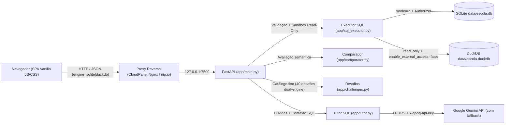
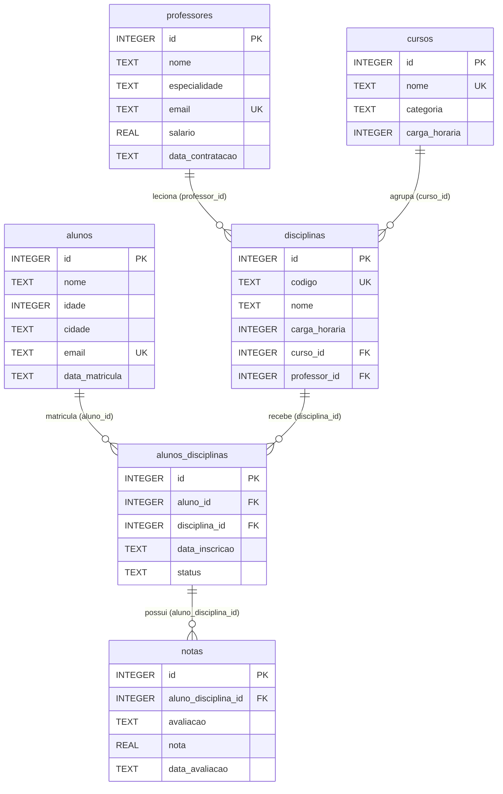

# Documentação Técnica — SQL Arena

Plataforma web interativa em **FastAPI + SQLite + DuckDB (Friendly SQL)** para prática de consultas SQL, com 40 desafios organizados por dificuldade (**Fácil**, **Médio** e **Difícil**), seletor de base de dados no frontend (**SQLite** vs **DuckDB Friendly SQL**), **Modo Livre**, **Explorador de Tabelas**, **DER visual (SVG)** e **Guia Rápido de Dialetos**.

---

## 1. Visão Geral da Arquitetura

### Princípios de Design
- **Execução segura e isolada nos dois motores**:
  - **SQLite**: validação sintática (`validate_readonly_sql`), conexão URI `?mode=ro`, `PRAGMA query_only = ON`, autorizador em lista branca (`_sql_authorizer`), `SQLITE_LIMIT_LENGTH` (100 KB), limite de linhas (`MAX_ROWS = 500`) e timeout via `set_progress_handler` (`1.5s`).
  - **DuckDB (Friendly SQL)**: validação sintática dedicada (permitindo `SELECT`, `WITH`, `FROM`-first, `PIVOT`, `UNPIVOT`, `DESCRIBE`, `SHOW`, `SUMMARIZE`, `VALUES` e bloqueando funções de leitura externa/sistema), conexão `read_only=True` com `enable_external_access=False`, `allow_community_extensions=False`, `autoinstall_known_extensions=False`, `autoload_known_extensions=False`, `lock_configuration=True`, `memory_limit="128MB"`, `threads=1`, `temp_directory` apontando para o diretório temporário do sistema (`max_temp_directory_size="32MB"`), e timeout via `threading.Timer` + `conn.interrupt()`.
- **Comparação independente da escrita**: o avaliador compara os **dados retornados** (com tolerância de aliases e arredondamento numérico), aceitando qualquer SQL válido no motor selecionado (ex.: `LEFT JOIN ... IS NULL` ou `NOT EXISTS`; no DuckDB, tanto SQL ANSI padrão quanto atalhos Friendly SQL).
- **Zero dependências externas no frontend**: HTML, CSS e JavaScript puros servidos diretamente pelo FastAPI, compatíveis com `Content-Security-Policy` restritiva (`default-src 'self'`).

---

## 2. Estrutura de Arquivos

| Caminho | Responsabilidade |
| :--- | :--- |
| `app/main.py` | Fábrica da aplicação FastAPI (`create_app`), middlewares de segurança, rate limiter, cache de schema por motor e rotas HTTP/REST. |
| `app/schemas.py` | Modelos Pydantic de entrada/saída da API, `DatabaseEngine` (`"sqlite"` \| `"duckdb"`) e contratos JSON. |
| `app/database.py` | DDLs (`SCHEMA_SQL` e `DUCKDB_SCHEMA_SQL`), massa de dados inicial compartilhada (seed), criação dos dois bancos e leitura de metadados. |
| `app/sql_executor.py` | Validação sintática por motor, sandbox SQLite/DuckDB, execução com timeout, sanitização de saída e tradução didática de erros. |
| `app/comparator.py` | Comparação semântica e geração de status linha a linha (`match`, `extra`, `missing`, `order`). |
| `app/challenges.py` | Catálogo fixo dos 40 desafios (`facil-1..10`, `medio-1..15`, `dificil-1..15`) com gabaritos, dicas e tópicos para SQLite e DuckDB Friendly SQL. |
| `app/tutor.py` | Integração com a API do Google Gemini (`GEMINI_API_KEY`) para o chat Tutor SQL especializado em SQLite ou DuckDB conforme o motor selecionado. |
| `app/static/index.html` | Estrutura HTML da interface, seletor de motor, modais (Explorador, DER e Guia SQL com aba Friendly SQL) e painéis de resultado. |
| `app/static/app.js` | Gerenciamento de estado por motor (progresso, rascunhos e histórico separados), editor SQL, formatador, autocomplete, tabela paginada/filtrável e DER em SVG. |
| `app/static/styles.css` | Tema escuro/claro por variáveis CSS, layout responsivo, seletor de motor e estilos de diff/modais/EXPLAIN. |
| `data/escola.db` | Banco SQLite pré-gerado para uso local. |
| `data/escola.duckdb` | Banco DuckDB pré-gerado com esquema e registros espelhados do SQLite. |
| `Dockerfile` / `docker-compose.yml` | Empacotamento endurecido para produção (usuário não-root, `HOME=/tmp`, filesystem `read_only`, `tmpfs` em `/tmp`, ambas as bases em `chmod 444`). |
| `deploy/` | Exemplos de configuração de proxy reverso (`Caddyfile` e `nginx-nipio.conf`). |
| `tests/` | Suíte automatizada `pytest` cobrindo ambos os bancos, paridade dos 40 desafios, executor/sandbox, comparador, Tutor IA e API. |

---

## 3. Documentação de Classes, Modelos e Módulos

### 3.1. `app/schemas.py` — Contratos da API (Pydantic)
Define `DifficultyLevel = Literal["facil", "medio", "dificil"]`, `DatabaseEngine = Literal["sqlite", "duckdb"]` e os modelos de serialização/validação:

- **`ColumnSchema(BaseModel)`**: descreve uma coluna de tabela (`name`, `type`, `nullable`, `primary_key`, `foreign_key`).
- **`TableSchema(BaseModel)`**: descreve uma tabela no esquema (`name`, `row_count`, lista de `ColumnSchema`).
- **`ChallengeSummary(BaseModel)`**: representação pública de um desafio enviada ao frontend (`id`, `nivel`, `titulo`, `enunciado`, `dica`, `ordem_importa`, `topicos`), adaptada ao `engine` solicitado sem expor o SQL de solução antecipadamente.
- **`QueryPayload(BaseModel)`**: payload de entrada dos endpoints `/api/execute` e `/api/explain`, validando `sql` (1 a 10.000 caracteres), `challenge_id` opcional e `engine: DatabaseEngine = "sqlite"`.
- **`TableResult(BaseModel)`**: resultado tabular de uma execução (`columns`, `rows`, `row_count`, `execution_ms`, `truncated`).
- **`ExpectedAnswer(BaseModel)`**: gabarito retornado no modo desafio contendo `sql` oficial do motor selecionado e `result` (`TableResult`).
- **`ExecuteQueryResponse(BaseModel)`**: resposta completa de `/api/execute` para modo `"challenge"` ou `"free"`, incluindo `engine`, `user_result`, `user_error`, `user_error_hint`, `expected`, `is_correct`, `feedback`, `user_row_status` e `expected_row_status`.
- **`ChatMessage(BaseModel)` / `ChatPayload(BaseModel)` / `ChatResponse(BaseModel)`**: contratos do chat Tutor SQL, transportando a pergunta, histórico recente, `engine`, query atual, desafio ativo, último erro/feedback e resposta do modelo.

### 3.2. `app/challenges.py` — Catálogo de Desafios
- **`Challenge` (`@dataclass(frozen=True)`)**: representa um desafio imutável com `id`, `nivel`, `titulo`, `enunciado`, `dica`, `solucao_sql`, `ordem_importa`, `topicos`, além de `solucao_duckdb`, `dica_duckdb`, `topicos_duckdb`, `titulo_duckdb` e `enunciado_duckdb`. Expõe `get_solution(engine)`, `get_title(engine)`, `get_description(engine)`, `get_hint(engine)` e `get_topics(engine)`.
- **`CHALLENGES` / `CHALLENGES_BY_ID`**: tupla e índice por ID com 40 desafios (10 fáceis, 15 médios, 15 difíceis).
- **`list_challenges(nivel)` / `get_challenge(challenge_id)`**: funções de consulta ao catálogo.

### 3.3. `app/database.py` — Criação, Seed e Introspecção (SQLite e DuckDB)
- **`DUCKDB_READONLY_CONFIG` / `connect_duckdb_readonly(db_path)`**: centraliza a configuração de abertura somente leitura do DuckDB com `enable_external_access=False`, `lock_configuration=True`, `memory_limit="128MB"`, `threads=1`, `temp_directory` em `tempfile.gettempdir()` e `max_temp_directory_size="32MB"`.
- **`create_and_seed_database(db_path, overwrite=False)` / `create_and_seed_duckdb(db_path, overwrite=False)` / `create_and_seed_all_databases(...)`**: criam os esquemas (`SCHEMA_SQL` e `DUCKDB_SCHEMA_SQL`) e inserem as mesmas listas de seed (`PROFESSORES_SEED`, `CURSOS_SEED`, `DISCIPLINAS_SEED`, `ALUNOS_SEED`, `ALUNOS_DISCIPLINAS_SEED`, `NOTAS_SEED`).
- **`ensure_database(db_path=None, engine="sqlite")`**: garante que o arquivo `.db` ou `.duckdb` exista antes de abrir conexões de leitura.
- **`get_schema_metadata(db_path=None, engine="sqlite")` / `get_duckdb_schema_metadata(db_path)`**: extraem metadados de tabelas, colunas, chaves (PK/FK) e contagens via `sqlite_master`/`PRAGMA` (SQLite) ou `duckdb_tables()`/`duckdb_columns()`/`duckdb_constraints()` (DuckDB).

### 3.4. `app/sql_executor.py` — Validação e Sandbox Dual-Engine
- **`SQLValidationError(ValueError)`**: exceção lançada quando a query é vazia, contém múltiplos statements, não começa com comando de leitura permitido, usa palavra-chave/função bloqueada ou gera valor não representável em JSON (`Inf`/`NaN`).
- **`SQLExecutionResult` (`@dataclass(frozen=True)`)**: encapsula `columns`, `rows`, `row_count`, `execution_ms` e `truncated`.
- **`_strip_comments_and_strings(sql, allow_bracket_identifiers=True, allow_dollar_strings=False, allow_nested_comments=False)`**: remove comentários (`-- ...`, `/* ... */` inclusive aninhados no DuckDB), literais `'...'`, `$$...$$`/`E'...'` no DuckDB e identificadores `"..."`, `` `...` `` e `[...]` (apenas no SQLite, preservando listas `[1, 2]` no DuckDB).
- **`validate_readonly_sql(sql, engine="sqlite")`**: garante instrução única somente leitura conforme as regras de cada motor (`SELECT`/`WITH` no SQLite; `SELECT`, `WITH`, `FROM`, `PIVOT`, `UNPIVOT`, `DESCRIBE`, `SHOW`, `SUMMARIZE`, `VALUES` no DuckDB, bloqueando `DUCKDB_FORBIDDEN_KEYWORDS` e `DUCKDB_BLOCKED_FUNCTIONS`).
- **`_sql_authorizer(...)`**: callback em lista branca para SQLite, permitindo apenas leitura e bloqueando `LOAD_EXTENSION`, `FTS3_TOKENIZER`, `ZEROBLOB` e `RANDOMBLOB`.
- **`_sanitize_cell(value)`**: rejeita `Inf`/`NaN` e strings acima de `MAX_SQLITE_VALUE_BYTES`, converte `Decimal` para `float`, datas/horas (`date`/`datetime`/`time`/`timedelta`) para ISO/string, `UUID` para string, `bytes` para hex (`X'...'`) e sanitiza listas/dicionários recursivamente.
- **`_run_sqlite_query(...)` / `_run_duckdb_query(...)`**: executam as consultas em modo somente leitura com limite de `500` linhas e timeout de `1.5s` (`set_progress_handler` no SQLite; `threading.Timer` + `conn.interrupt()` no DuckDB).
- **`execute_readonly_sql(..., engine="sqlite")` / `explain_readonly_sql(..., engine="sqlite")`**: executam a query do usuário ou seu plano (`EXPLAIN QUERY PLAN` no SQLite; `EXPLAIN` no DuckDB).
- **`translate_sqlite_error(error_msg)` / `translate_duckdb_error(error_msg)` / `translate_sql_error(error_msg, engine="sqlite")`**: convertem erros técnicos de cada banco em dicas didáticas em português.

### 3.5. `app/comparator.py` — Avaliador Semântico
- **`ComparisonResult` (`@dataclass(frozen=True)`)**: resultado da comparação (`is_correct`, `feedback`, `user_row_status`, `expected_row_status`).
- **`_normalize_cell(value)` / `_normalize_rows(rows)`**: normaliza valores numéricos (`round(float(value), 2)`) para tolerar diferenças entre `int`/`float` e precisão decimal.
- **`_compute_multiset_diff(norm_user, norm_expected)`**: usa `collections.Counter` para classificar cada linha do usuário como `"match"` ou `"extra"`, e cada linha do gabarito como `"match"` ou `"missing"`.
- **`compare_results(user_result, expected_result, order_matters=False)`**: compara quantidade de colunas e conteúdo das linhas. Quando `order_matters=True`, distingue acerto exato, registros corretos em ordem errada (`"order"`) e divergência de dados.

### 3.6. `app/main.py` — Servidor FastAPI e Rate Limiting
- **`SlidingWindowRateLimiter`**: limitador em memória por IP com janela deslizante configurável (`60s` por minuto ou `86.400s` por dia) protegida por `threading.Lock`, com limpeza periódica (`_prune_stale_buckets`) e cálculo de saldo (`remaining`).
- **`_extract_client_ip(request)`**: extrai o IP do cliente priorizando `X-Real-IP` e o último item de `X-Forwarded-For` (adicionado pelo proxy reverso confiável), prevenindo spoofing pelo cabeçalho inicial.
- **`_load_local_dotenv()`**: carrega o `.env` local automaticamente fora do `pytest` e sem sobrescrever variáveis já definidas no ambiente/Docker.
- **`create_app(db_path, duckdb_path, rate_limit_per_minute, chat_rate_limit_per_minute, chat_daily_limit_per_user)`**: configura ambiente (`APP_ENV`), `TrustedHostMiddleware` (`ALLOWED_HOSTS`), headers de segurança/CSP (`add_security_headers`), cache de schema por motor (`application.state.schema_cache`), ciclo de vida (`lifespan`) e endpoints:
  - `GET /`: entrega `app/static/index.html`.
  - `GET /api/health`: healthcheck utilizado pelo Docker (garante ambos os arquivos).
  - `GET /api/schema?engine=sqlite|duckdb`: retorna o esquema cacheado das tabelas do motor escolhido.
  - `GET /api/tables/{table_name}?engine=sqlite|duckdb`: paginação, ordenação e busca textual (com escape de `%`, `_` e `\`) nas tabelas do banco selecionado, com rate limit dedicado.
  - `GET /api/challenges?engine=sqlite|duckdb`: lista desafios com filtro opcional por `nivel` e metadados do motor selecionado.
  - `POST /api/execute`: executa consulta em Modo Livre ou avalia contra o gabarito do desafio no motor `payload.engine`.
  - `POST /api/explain`: executa `EXPLAIN QUERY PLAN` (SQLite) ou `EXPLAIN` (DuckDB).
  - `GET /api/chat/status`: informa se o agente Gemini (`GEMINI_API_KEY`) está configurado e qual `GEMINI_MODEL` está ativo.
  - `POST /api/chat`: envia a dúvida do usuário com contexto SQL e esquema do motor selecionado para `app/tutor.py` (`ask_gemini_tutor`), protegido por `CHAT_RATE_LIMIT_PER_MINUTE`.

### 3.7. `app/tutor.py` — Agente Tutor SQL (Google Gemini)
- **`TutorConfigError` / `TutorUpstreamError`**: exceções tipadas para chave ausente (`503`) ou falha na API externa (`502`).
- **`build_schema_context(schema)` / `build_tutor_system_prompt(schema_text, engine="sqlite")`**: formata as 6 tabelas e instrui o Gemini como tutor especialista em **SQLite** ou **DuckDB (Friendly SQL)** conforme o motor ativo, com **regra explícita de recusa** para assuntos fora de SQL/bancos relacionais.
- **`build_user_turn_with_context(payload, challenge)`**: anexa à pergunta do aluno o motor ativo, o enunciado/dica/referência interna do desafio para aquele motor, a query do editor, o último erro e o resumo do último resultado (com truncamento via `_clip_text`).
- **`ask_gemini_tutor(payload, schema, challenge)`**: chama a Gemini REST API via `httpx.post` com a chave no header `x-goog-api-key`, usando `GEMINI_MODEL` (padrão `gemini-3.5-flash-lite`) e fallback automático em `GEMINI_FALLBACK_MODELS` (`gemini-3.5-flash`, `gemini-2.5-flash-lite`, `gemini-2.5-flash`), com `GEMINI_THINKING_LEVEL=minimal`, `GEMINI_MAX_OUTPUT_TOKENS=450`, `CHAT_MAX_HISTORY_MESSAGES=6` e limites por IP.

### 3.8. Frontend (`app/static/app.js`, `index.html`, `styles.css`)
- **Seleção de Motor e Estado Separado (`setEngine`, `applyEngineUi`, `ENGINE_META`)**: alterna entre `SQLite` e `DuckDB (Friendly SQL)` na barra superior mantendo `solvedByEngine`, `historyByEngine` e rascunhos (`${engine}:${id}`) isolados no `localStorage` (com migração automática dos dados legados para `sqlite`).
- **Persistência segura (`storageGetJson` / `storageSet`)**: encapsula acesso ao `localStorage` com `try/catch` para evitar quebra em caso de JSON corrompido ou restrições de privacidade do navegador.
- **Editor SQL (`initEditor`, `highlightSqlToHtml`, `updateAutocomplete`, `formatSqlQuery`, `updateLineNumbers`)**: suporte a `Ctrl+Enter`, `Ctrl+Espaço`, indentação por `Tab`, destaque de sintaxe incluindo palavras-chave Friendly SQL, autocomplete contextual por motor (`a.`), formatador e templates do Modo Livre específicos para SQLite e DuckDB.
- **Resultados, Navegação e Exportação (`renderExecutionResponse`, `setExpectedSqlVisible`, `exportUserCsv`, `updateProgressPill`)**: navegação `‹`/`›` entre desafios, botão **Próximo desafio ›**, popover de progresso por nível (com resumo da outra tecnologia), exportação em CSV (UTF-8 BOM), exibição dedicada `.explain-table` para planos de execução e solução SQL oculta atrás de **Revelar solução**.
- **Chat Tutor SQL (`initChat`, `openChatDrawer`, `sendChatMessage`)**: gaveta retrátil no canto inferior direito enviando o `engine` ativo e contexto da execução.
- **Modais auxiliares**: **Explorador de Dados** (`openDataBrowser`, `loadBrowserData`), **Mapeamento DER** (`renderDerDiagram`, `drawDerConnectors` em SVG) e **Guia Rápido SQL** (com aba dedicada a **Friendly SQL (DuckDB)** e tabela comparativa de dialetos).

---

## 4. Bases de Dados (`data/escola.db` e `data/escola.duckdb`)

Ambas as bases simulam o mesmo ambiente acadêmico com **6 tabelas**, os mesmos registros e relacionamentos **1:N** e **N:N** (no DuckDB, as datas utilizam tipo `DATE` e valores monetários/notas utilizam `DECIMAL(10, 2)` / `DECIMAL(4, 2)` para garantir aritmética decimal exata e paridade de resultados com o SQLite):

### Detalhes das Tabelas e Regras
- **`professores` (10 registros)**: docentes com especialidade, e-mail único, salário e data de contratação.
- **`cursos` (12 registros)**: cursos únicos com categoria (`Tecnologia`, `Engenharia`, `Dados`, `Infraestrutura`, `Gestão`) e carga horária.
- **`disciplinas` (20 registros)**: código único (ex.: `BD101`), nome, carga horária e FKs para `cursos(id)` e `professores(id)`.
- **`alunos` (50 registros)**: dados cadastrais com `email` único. **Alunos 25 e 50 não possuem matrículas** propositalmente para exercícios de `LEFT JOIN` / `NOT EXISTS` / `ANTI JOIN`.
- **`alunos_disciplinas` (108 registros)**: tabela associativa N:N entre `alunos` e `disciplinas`, com `UNIQUE (aluno_id, disciplina_id)` e `CHECK (status IN ('cursando', 'concluida', 'trancada'))`.
- **`notas` (159 registros)**: avaliações (`P1`, `P2`, `Trabalho`, `Projeto Final`) ligadas a `alunos_disciplinas(id)` com `CHECK (nota >= 0 AND nota <= 10)`. **Matrículas 55 e 108 não possuem notas lançadas** propositalmente para cenários de `LEFT JOIN ... IS NULL` / `ANTI JOIN`.
- **Índices de FK**: `idx_disciplinas_curso_id`, `idx_disciplinas_professor_id`, `idx_alunos_disciplinas_aluno_id`, `idx_alunos_disciplinas_disciplina_id`, `idx_notas_aluno_disciplina_id`.

---

## 5. Registro de Alterações e Melhorias Aplicadas

| Área | Problema Anterior | Alteração Realizada |
| :--- | :--- | :--- |
| **Concorrência FastAPI** | Rotas `async def` faziam chamadas síncronas ao `sqlite3`, podendo travar o event loop em queries próximas ao timeout. | Rotas com I/O SQLite convertidas para `def` em `app/main.py` para execução no threadpool do FastAPI. |
| **Sandbox SQLite** | Dependia apenas de blacklist de palavras e `mode=ro`; `zeroblob` ou `1e999`/`X'ff'` causavam alocação alta ou HTTP 500. | Adicionados `_sql_authorizer` (whitelist), `SQLITE_LIMIT_LENGTH` (100 KB), `_sanitize_cell` (tratando `Inf`/`NaN` e `bytes`), suporte a `` `...` `` e `[...]` em `_strip_comments_and_strings` e dicas de erro correspondentes. |
| **Rate Limiter e IP** | `_extract_client_ip` usava o primeiro IP de `X-Forwarded-For` (passível de spoofing); `_hits` nunca limpava IPs antigos; `/api/tables` sem limite. | Priorização de `X-Real-IP` e último IP de `X-Forwarded-For`, poda periódica (`_prune_stale_buckets`), rate limit dedicado em `browse_table` e escape de `%`/`_`/`\` na busca `LIKE`. |
| **Performance e Índices** | `/api/tables` e `/api/schema` reexecutavam `PRAGMA` + 6 `COUNT(*)` a cada requisição; FKs sem índices faziam `EXPLAIN` mostrar sempre `SCAN`. | Schema cacheado em `application.state.schema_cache` e adicionados 5 índices nas FKs em `app/database.py` (com `data/escola.db` atualizado). |
| **Container Docker** | `read_only: true` sem `TMPDIR=/tmp` (SQLite tenta `/var/tmp` antes de `/tmp`) e `Dockerfile` ignorava versões do `requirements.txt`. | Adicionados `TMPDIR=/tmp`, `SQLITE_TMPDIR=/tmp` e `HOME=/tmp` no `Dockerfile`, criado `requirements-prod.txt` compartilhado com `requirements.txt` e adicionados `docs/` e `data/` no `.dockerignore`. |
| **Experiência do Aluno (UI)** | Gabarito SQL aparecia aberto logo na primeira tentativa errada; resizer horizontal travava largura no Modo Livre; troca de desafio mantinha resultados antigos; `BETWEEN ... AND` quebrava linha; numeração dessincronizava em linhas longas; `localStorage` sem `try/catch`. | Botão **Revelar/Ocultar solução** (`setExpectedSqlVisible`), `!important` em `.result-pane.single-full`, `resetResultsView()` ao trocar desafio/modo, proteção de `BETWEEN ... AND ...` no formatador, `white-space: pre` no `.sql-textarea`, tratamento de erro em `loadBrowserData`, `CSS.escape` no DER, helpers seguros de `localStorage`, highlight/autocomplete local, exportação CSV, navegação `‹`/`›`, templates no Modo Livre e popover de progresso por nível. |
| **Catálogo de Desafios** | 30 desafios iniciais (10 por nível). | Expandido para **40 desafios** (`facil-1..10`, `medio-1..15`, `dificil-1..15`) e clarificação da ordenação alfabética em `facil-7`. |
| **Tutor SQL (Gemini)** | Sem assistente para tirar dúvidas sobre erros das queries. | Adicionados `app/tutor.py`, `/api/chat`, `/api/chat/status` e gaveta retrátil no frontend com fallback automático entre modelos, `thinkingLevel=minimal`, restrição estrita a SQL e limites de mensagens/tokens por IP. |
| **Suporte Dual-Engine (SQLite + DuckDB Friendly SQL)** | Apenas SQLite disponível para treino e gabaritos. | Adicionada segunda base `data/escola.duckdb` com os mesmos registros (usando `DATE` e `DECIMAL` para paridade numérica exata), sandbox DuckDB (`enable_external_access=false`, `lock_configuration=true`, `temp_directory` em `/tmp`, `threading.Timer` + `interrupt`), gabaritos/dicas/tópicos Friendly SQL nos 40 desafios, tradutor de erros DuckDB, suporte dual-engine no Tutor Gemini e seletor no frontend com progresso, rascunhos e histórico separados por tecnologia. |
