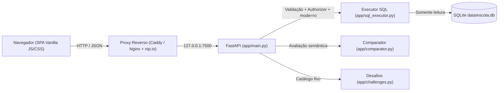
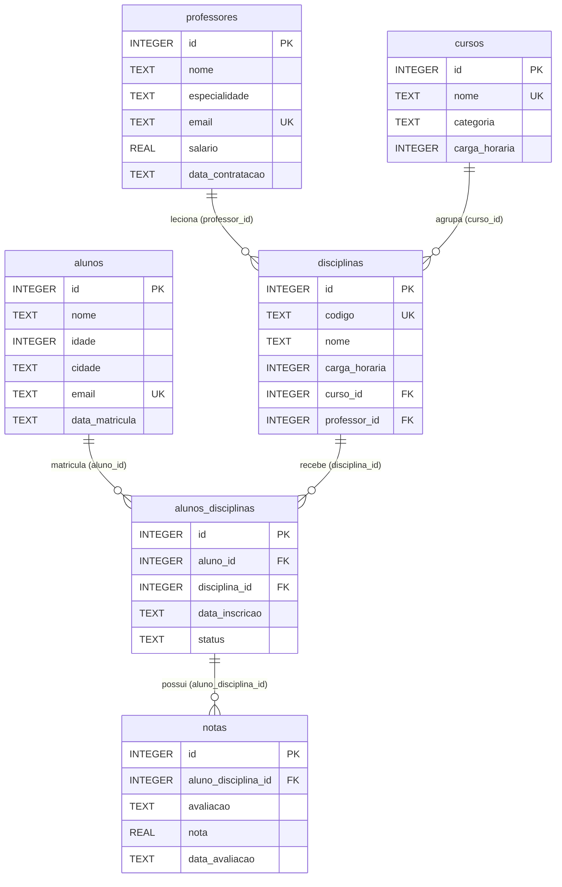

# Documentação Técnica — SQL Arena

Plataforma web interativa em **FastAPI + SQLite** para prática de consultas SQL (`SELECT` e `WITH`), com 40 desafios organizados por dificuldade (**Fácil**, **Médio** e **Difícil**), **Modo Livre**, **Explorador de Tabelas**, **DER visual (SVG)** e **Guia Rápido de Dialetos**.

---

## 1. Visão Geral da Arquitetura

### Princípios de Design
- **Execução segura e isolada**: toda consulta do usuário passa por validação sintática (`validate_readonly_sql`), conexão SQLite aberta com `?mode=ro`, `PRAGMA query_only = ON`, autorizador em lista branca (`_sql_authorizer`), limite de tamanho de valores (`SQLITE_LIMIT_LENGTH`), limite de linhas (`MAX_ROWS = 500`) e timeout por progress handler (`1.5s`).
- **Comparação independente da escrita**: o avaliador compara os **dados retornados** (com tolerância de aliases e arredondamento numérico), aceitando diferentes formas corretas de escrever a mesma consulta (por exemplo, `LEFT JOIN ... IS NULL` ou `NOT EXISTS`).
- **Zero dependências externas no frontend**: HTML, CSS e JavaScript puros servidos diretamente pelo FastAPI, compatíveis com `Content-Security-Policy` restritiva (`default-src 'self'`).

---

## 2. Estrutura de Arquivos

| Caminho | Responsabilidade |
| :--- | :--- |
| `app/main.py` | Fábrica da aplicação FastAPI (`create_app`), middlewares de segurança, rate limiter e rotas HTTP/REST. |
| `app/schemas.py` | Modelos Pydantic de entrada/saída da API e contratos JSON. |
| `app/database.py` | DDL (`SCHEMA_SQL`), massa de dados inicial (seed), criação do banco e leitura de metadados. |
| `app/sql_executor.py` | Validação, sandbox/authorizer SQLite, execução com timeout, sanitização de saída e tradução didática de erros. |
| `app/comparator.py` | Comparação semântica e geração de status linha a linha (`match`, `extra`, `missing`, `order`). |
| `app/challenges.py` | Catálogo fixo dos 40 desafios (`facil-1..10`, `medio-1..15`, `dificil-1..15`). |
| `app/static/index.html` | Estrutura HTML da interface, modais (Explorador, DER e Guia SQL) e painéis de resultado. |
| `app/static/app.js` | Gerenciamento de estado, editor SQL, formatador, tabela paginada/filtrável no cliente e renderização do DER em SVG. |
| `app/static/styles.css` | Tema escuro/claro por variáveis CSS, layout responsivo e estilos de diff/modais. |
| `data/escola.db` | Banco SQLite pré-gerado para uso local. |
| `Dockerfile` / `docker-compose.yml` | Empacotamento endurecido para produção (usuário não-root, filesystem `read_only`, `tmpfs` em `/tmp`). |
| `deploy/` | Exemplos de configuração de proxy reverso (`Caddyfile` e `nginx-nipio.conf`). |
| `tests/` | Suíte automatizada `pytest` cobrindo banco, executor, comparador, desafios e API. |

---

## 3. Documentação de Classes, Modelos e Módulos

### 3.1. `app/schemas.py` — Contratos da API (Pydantic)
Define o tipo `DifficultyLevel = Literal["facil", "medio", "dificil"]` e os modelos de serialização/validação:

- **`ColumnSchema(BaseModel)`**: descreve uma coluna de tabela (`name`, `type`, `nullable`, `primary_key`, `foreign_key`).
- **`TableSchema(BaseModel)`**: descreve uma tabela no esquema (`name`, `row_count`, lista de `ColumnSchema`).
- **`ChallengeSummary(BaseModel)`**: representação pública de um desafio enviada ao frontend (`id`, `nivel`, `titulo`, `enunciado`, `dica`, `ordem_importa`, `topicos`). Não expõe `solucao_sql` antecipadamente na listagem.
- **`QueryPayload(BaseModel)`**: payload de entrada dos endpoints `/api/execute` e `/api/explain`, validando `sql` (1 a 10.000 caracteres) e `challenge_id` opcional.
- **`TableResult(BaseModel)`**: resultado tabular de uma execução (`columns`, `rows`, `row_count`, `execution_ms`, `truncated`).
- **`ExpectedAnswer(BaseModel)`**: gabarito retornado no modo desafio contendo `sql` oficial e `result` (`TableResult`).
- **`ExecuteQueryResponse(BaseModel)`**: resposta completa de `/api/execute` para modo `"challenge"` ou `"free"`, reunindo `user_result`, `user_error`, `user_error_hint`, `expected`, `is_correct`, `feedback`, `user_row_status` e `expected_row_status`.

### 3.2. `app/challenges.py` — Catálogo de Desafios
- **`Challenge` (`@dataclass(frozen=True)`)**: representa um desafio imutável com `id`, `nivel`, `titulo`, `enunciado`, `dica`, `solucao_sql`, `ordem_importa` e `topicos`.
- **`CHALLENGES` / `CHALLENGES_BY_ID`**: tupla e índice por ID com 40 desafios (10 fáceis, 15 médios, 15 difíceis).
- **`list_challenges(nivel)` / `get_challenge(challenge_id)`**: funções de consulta ao catálogo.

### 3.3. `app/database.py` — Criação, Seed e Introspecção do SQLite
- **`create_and_seed_database(db_path, overwrite=False)`**: cria o esquema definido em `SCHEMA_SQL` (com chaves estrangeiras e índices) e insere todas as listas de seed em transação única.
- **`ensure_database(db_path)`**: garante que o arquivo `.db` exista antes de abrir conexões de leitura.
- **`get_schema_metadata(db_path)`**: lê `sqlite_master`, `PRAGMA foreign_key_list` e `PRAGMA table_info` para montar o dicionário de tabelas, colunas, chaves e contagens usado pela barra lateral, DER e validador de tabelas.

### 3.4. `app/sql_executor.py` — Validação e Sandbox SQLite
- **`SQLValidationError(ValueError)`**: exceção lançada quando a query é vazia, contém múltiplos statements, não começa com `SELECT`/`WITH`, usa palavra-chave bloqueada ou produz valor numérico não representável em JSON (`Inf`/`NaN`).
- **`SQLExecutionResult` (`@dataclass(frozen=True)`)**: encapsula `columns`, `rows`, `row_count`, `execution_ms` e `truncated`.
- **`_strip_comments_and_strings(sql)`**: remove comentários (`-- ...`, `/* ... */`), literais `'...'` e identificadores `"..."`, `` `...` `` e `[...]` antes de tokenizar a query, evitando falsos positivos (ex.: `'DROP TABLE'` dentro de string) e falsos negativos.
- **`validate_readonly_sql(sql)`**: garante instrução única iniciada por `SELECT` ou `WITH` e sem palavras de `FORBIDDEN_KEYWORDS`.
- **`_sql_authorizer(...)`**: callback registrado via `conn.set_authorizer` em lista branca; permite apenas `SQLITE_SELECT`, `SQLITE_READ`, `SQLITE_RECURSIVE` e `SQLITE_FUNCTION`, bloqueando funções perigosas ou de alocação massiva (`LOAD_EXTENSION`, `FTS3_TOKENIZER`, `ZEROBLOB`, `RANDOMBLOB`).
- **`_sanitize_cell(value)`**: rejeita `Inf`/`NaN` com `SQLValidationError` e converte `bytes`/`memoryview` em representação hexadecimal segura (`X'...'`) para evitar erros de serialização UTF-8/JSON.
- **`_run_sqlite_query(...)`**: abre conexão URI `?mode=ro`, ativa `PRAGMA query_only = ON`, limita tamanho máximo de strings/blobs via `SQLITE_LIMIT_LENGTH` (100 KB), aplica `_sql_authorizer` e interrompe queries lentas via `set_progress_handler` após `1.5s`.
- **`execute_readonly_sql(...)` / `explain_readonly_sql(...)`**: executam a query do usuário ou seu `EXPLAIN QUERY PLAN`.
- **`translate_sqlite_error(error_msg)`**: converte erros técnicos do SQLite (coluna ambígua, coluna inexistente, agregação no `WHERE`, sintaxe, função inexistente etc.) em dicas didáticas em português.

### 3.5. `app/comparator.py` — Avaliador Semântico
- **`ComparisonResult` (`@dataclass(frozen=True)`)**: resultado da comparação (`is_correct`, `feedback`, `user_row_status`, `expected_row_status`).
- **`_normalize_cell(value)` / `_normalize_rows(rows)`**: normaliza valores numéricos (`round(float(value), 2)`) para tolerar diferenças entre `int`/`float` e precisão decimal.
- **`_compute_multiset_diff(norm_user, norm_expected)`**: usa `collections.Counter` para classificar cada linha do usuário como `"match"` ou `"extra"`, e cada linha do gabarito como `"match"` ou `"missing"`.
- **`compare_results(user_result, expected_result, order_matters=False)`**: compara quantidade de colunas e conteúdo das linhas. Quando `order_matters=True`, distingue acerto exato, registros corretos em ordem errada (`"order"`) e divergência de dados.

### 3.6. `app/main.py` — Servidor FastAPI e Rate Limiting
- **`SlidingWindowRateLimiter`**: limitador em memória por IP com janela deslizante de 60s protegida por `threading.Lock` e limpeza periódica (`_prune_stale_buckets`) para evitar vazamento de memória por acúmulo de IPs antigos.
- **`_extract_client_ip(request)`**: extrai o IP do cliente priorizando `X-Real-IP` e o último item de `X-Forwarded-For` (adicionado pelo proxy reverso confiável), prevenindo spoofing pelo cabeçalho inicial.
- **`create_app(db_path, rate_limit_per_minute)`**: configura ambiente (`APP_ENV`), `TrustedHostMiddleware` (`ALLOWED_HOSTS`), middleware de headers de segurança/CSP (`add_security_headers`), cache do schema em `application.state.schema_cache`, ciclo de vida (`lifespan`) e endpoints:
  - `GET /`: entrega `app/static/index.html`.
  - `GET /api/health`: healthcheck utilizado pelo Docker.
  - `GET /api/schema`: retorna o esquema cacheado das tabelas.
  - `GET /api/tables/{table_name}`: paginação, ordenação e busca textual (com escape de `%`, `_` e `\`) nas tabelas do banco, com rate limit dedicado para navegação.
  - `GET /api/challenges`: lista desafios com filtro opcional por `nivel`.
  - `POST /api/execute`: executa consulta em Modo Livre ou avalia contra o gabarito do desafio.
  - `POST /api/explain`: executa `EXPLAIN QUERY PLAN`.

### 3.7. Frontend (`app/static/app.js`, `index.html`, `styles.css`)
- **Estado central (`state` e `createTableState`)**: mantém modo atual (`challenge`/`free`), nível, filtro de tópico, lista de desafios, IDs resolvidos, histórico de queries, rascunhos por desafio e estado de paginação/ordenação/filtro local das tabelas de resultado.
- **Persistência segura (`storageGetJson` / `storageSet`)**: encapsula acesso ao `localStorage` com `try/catch` para evitar quebra em caso de JSON corrompido ou restrições de privacidade do navegador.
- **Editor SQL (`initEditor`, `formatSqlQuery`, `updateLineNumbers`)**: suporte a `Ctrl+Enter`, indentação por `Tab`, numeração sincronizada com scroll horizontal (`white-space: pre`) e formatador com proteção de literais, comentários e `BETWEEN ... AND ...`.
- **Resultados e Gabarito (`renderExecutionResponse`, `setExpectedSqlVisible`, `resetResultsView`)**: exibe o resultado do usuário e o resultado esperado lado a lado com destaque visual linha a linha (`row-extra`, `row-missing`, `row-order`). A query SQL do gabarito fica oculta até o usuário acertar ou clicar em **Revelar solução**.
- **Modais auxiliares**: **Explorador de Dados** (`openDataBrowser`, `loadBrowserData`), **Mapeamento DER** (`renderDerDiagram`, `drawDerConnectors` desenhando cardinalidades `1:N` em SVG dinâmico) e **Guia Rápido SQL**.

---

## 4. Banco de Dados (`data/escola.db`)

O banco simula um ambiente acadêmico com **6 tabelas** e relacionamentos **1:N** e **N:N**:

### Detalhes das Tabelas e Regras
- **`professores` (10 registros)**: docentes com especialidade, e-mail único, salário e data de contratação.
- **`cursos` (12 registros)**: cursos únicos com categoria (`Tecnologia`, `Engenharia`, `Dados`, `Infraestrutura`, `Gestão`) e carga horária.
- **`disciplinas` (20 registros)**: código único (ex.: `BD101`), nome, carga horária e FKs para `cursos(id)` e `professores(id)`.
- **`alunos` (50 registros)**: dados cadastrais com `email` único. **Alunos 25 e 50 não possuem matrículas** propositalmente para exercícios de `LEFT JOIN` / `NOT EXISTS`.
- **`alunos_disciplinas` (108 registros)**: tabela associativa N:N entre `alunos` e `disciplinas`, com `UNIQUE (aluno_id, disciplina_id)` e `CHECK (status IN ('cursando', 'concluida', 'trancada'))`.
- **`notas` (159 registros)**: avaliações (`P1`, `P2`, `Trabalho`, `Projeto Final`) ligadas a `alunos_disciplinas(id)` com `CHECK (nota >= 0 AND nota <= 10)`. **Matrículas 55 e 108 não possuem notas lançadas** propositalmente para cenários de `LEFT JOIN ... IS NULL`.
- **Índices de FK**: `idx_disciplinas_curso_id`, `idx_disciplinas_professor_id`, `idx_alunos_disciplinas_aluno_id`, `idx_alunos_disciplinas_disciplina_id`, `idx_notas_aluno_disciplina_id`.

---

## 5. Registro de Alterações e Melhorias Aplicadas

| Área | Problema Anterior | Alteração Realizada |
| :--- | :--- | :--- |
| **Concorrência FastAPI** | Rotas `async def` faziam chamadas síncronas ao `sqlite3`, podendo travar o event loop em queries próximas ao timeout. | Rotas com I/O SQLite convertidas para `def` em `app/main.py` para execução no threadpool do FastAPI. |
| **Sandbox SQLite** | Dependia apenas de blacklist de palavras e `mode=ro`; `zeroblob` ou `1e999`/`X'ff'` causavam alocação alta ou HTTP 500. | Adicionados `_sql_authorizer` (whitelist), `SQLITE_LIMIT_LENGTH` (100 KB), `_sanitize_cell` (tratando `Inf`/`NaN` e `bytes`), suporte a `` `...` `` e `[...]` em `_strip_comments_and_strings` e dicas de erro correspondentes. |
| **Rate Limiter e IP** | `_extract_client_ip` usava o primeiro IP de `X-Forwarded-For` (passível de spoofing); `_hits` nunca limpava IPs antigos; `/api/tables` sem limite. | Priorização de `X-Real-IP` e último IP de `X-Forwarded-For`, poda periódica (`_prune_stale_buckets`), rate limit dedicado em `browse_table` e escape de `%`/`_`/`\` na busca `LIKE`. |
| **Performance e Índices** | `/api/tables` e `/api/schema` reexecutavam `PRAGMA` + 6 `COUNT(*)` a cada requisição; FKs sem índices faziam `EXPLAIN` mostrar sempre `SCAN`. | Schema cacheado em `application.state.schema_cache` e adicionados 5 índices nas FKs em `app/database.py` (com `data/escola.db` atualizado). |
| **Container Docker** | `read_only: true` sem `TMPDIR=/tmp` (SQLite tenta `/var/tmp` antes de `/tmp`) e `Dockerfile` ignorava versões do `requirements.txt`. | Adicionados `TMPDIR=/tmp` e `SQLITE_TMPDIR=/tmp` no `Dockerfile`, criado `requirements-prod.txt` compartilhado com `requirements.txt` e adicionados `docs/` e `data/` no `.dockerignore`. |
| **Experiência do Aluno (UI)** | Gabarito SQL aparecia aberto logo na primeira tentativa errada; resizer horizontal travava largura no Modo Livre; troca de desafio mantinha resultados antigos; `BETWEEN ... AND` quebrava linha; numeração dessincronizava em linhas longas; `localStorage` sem `try/catch`. | Botão **Revelar/Ocultar solução** (`setExpectedSqlVisible`), `!important` em `.result-pane.single-full`, `resetResultsView()` ao trocar desafio/modo, proteção de `BETWEEN ... AND ...` no formatador, `white-space: pre` no `.sql-textarea`, tratamento de erro em `loadBrowserData`, `CSS.escape` no DER e helpers seguros de `localStorage`. |
